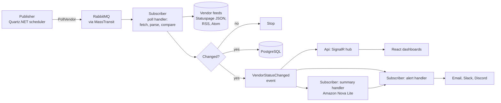

# StatusTide

[](https://github.com/hossem7/StatusTide/actions/workflows/ci.yml)

One dashboard for the status of every service your stack depends on, with independent checks running alongside each vendor's official status page.

> **Project status: in development.** The plan, screen designs and backlog are done, and code starts with [milestone 1](https://github.com/hossem7/StatusTide/milestone/1). Nothing is deployed yet. Progress is tracked in [milestones](https://github.com/hossem7/StatusTide/milestones) and [issues](https://github.com/hossem7/StatusTide/issues).

## The problem

When production breaks, the first question is usually "is it us, or something we depend on?" Answering it means opening GitHub's status page, then Slack's, then AWS's, one tab at a time. And official status pages tend to lag: a vendor posts an incident once its own engineers have confirmed it, which is often after customers have already started seeing errors.

## What StatusTide does

- **Follow only what you use.** Pick services from a catalog, then pick components within them (for example only "Actions" on GitHub). Alerts only fire for those.
- **One live dashboard.** Status changes are pushed to the browser over SignalR, so there's nothing to refresh.
- **Our checks next to theirs.** StatusTide calls each vendor's public health endpoint every minute and shows the result beside the official status. When our checks fail before the vendor posts, the incident page says so: "caught 4 minutes early".
- **Quiet alerts.** One message when an incident starts and one when it ends, by email, Slack or Discord.
- **Short incident summaries.** A plain-English summary written by an LLM, from facts only (see design decisions below).
- **Try it without signing up.** Guest mode gives you a real dashboard, including a demo vendor, Acme Cloud, that you can break on purpose to watch the whole pipeline react.

## How it works



The system is split into publishers and subscribers that only talk through RabbitMQ. The Publisher queues one `PollVendor` message per vendor per interval, however many people follow that vendor. The Subscriber's poll handler fetches the feed with a conditional request (ETag or If-Modified-Since), normalizes the response, hashes it and compares the hash with the last one stored in Redis. Most polls end right there. Only a real change is written to PostgreSQL and published as a `VendorStatusChanged` event, which then fans out to dashboards, alerts and the summarizer.

The result is that load and cost grow with the number of vendors in the catalog, not the number of users.

## Project structure

| Project | Role |
| --- | --- |
| `StatusTide.Api` | ASP.NET Core Web API (controllers) and the SignalR hub. Subscribes to status events to push live updates. |
| `StatusTide.Publisher` | Scheduled jobs that publish work to the queue. Runs as a single replica so polls are never queued twice. |
| `StatusTide.Subscriber` | Message consumers, grouped by feature: polling, checks, alerts, summaries. Scales out to as many replicas as needed. |
| `StatusTide.Contracts` | The messages (commands and events) shared by every project. Plain records with no dependencies. |
| `StatusTide.Common` | Shared plumbing: logging and MassTransit setup, used by every executable. |
| `StatusTide.Data` | The PostgreSQL schema: EF Core entities, migrations and the demo vendor seed. |
| `WebUI` | React and TypeScript frontend (Vite). |
| `tests/` | Unit tests, and integration tests against a real PostgreSQL in Testcontainers (needs Docker). |

Messaging uses MassTransit over RabbitMQ. Every consumer retries failed messages 5 times with exponential backoff (1 to 30 seconds); anything that still fails lands in an `_error` queue to be inspected and replayed, so no message is silently lost.

## Design decisions

**One poll per vendor, not per user.** A thousand people following GitHub still means one request to GitHub per minute. This is the core of the architecture and the reason for the queue and the fingerprinting step above.

**Publishers and subscribers instead of one big worker.** Scheduling and processing run as separate apps that only share message contracts. The Publisher runs as exactly one copy, which is what keeps polls from being queued twice, while the Subscriber can scale out freely. Writes come from the pipeline and reads are served from a Redis cache that the same events keep fresh, so busy dashboards never slow down the write path.

**Read published feeds, never scrape.** StatusTide only reads formats vendors publish for programs: Atlassian Statuspage JSON, Slack's status API, Google Cloud's Atom feed and plain RSS or Atom. There is no HTML scraping and no LLM reading arbitrary pages. The trade-off is that some vendors can't be supported, and that's accepted. Before a vendor joins the catalog, its format, terms of service, API terms and robots.txt are reviewed and the decision is recorded in the database, and reviewed again every six months.

**Show facts and link to the source.** StatusTide stores and displays statuses, component names, incident titles, timestamps and a link back to the vendor. It never stores or shows the vendor's written incident updates. That keeps the app on the right side of vendors' content, and it means the AI never paraphrases someone else's words. Vendors appear by name with initials tiles, no logos.

**Treat the LLM as a formatter, not a source.** The summarizer gets statuses, component names, timestamps and our own check data. Incident titles are text from outside the system, so all input is wrapped as untrusted data to blunt prompt injection. The model must return strict JSON, which is validated before saving; anything invalid falls back to a template sentence. Summaries are generated only when an incident opens, changes or resolves, so the cost is a few cents a month. They're labeled "AI-generated" in the UI.

**Confirm before alarming.** A component is marked down by our checks only after three failures in a row. That makes our detection about two minutes later than the first failed check, but one slow response shouldn't wake anyone up, and noisy alerts are the fastest way to get an alert tool muted.

**Guests are real users.** "Try it as a guest" creates a guest user on the server and a secure HttpOnly cookie, instead of keeping state in the browser. The cookie holds a random token and the database keeps only its hash. Visitors exercise the same backend as account holders, and signing up just transfers ownership of the guest's data. Guests inactive for 30 days are deleted by a cleanup job. Guests get in-app alerts only and lower limits, so the open door can't be used to send email.

**The server fetches URLs, so SSRF is designed in.** Account holders can add their own status page by URL, which means the server will fetch addresses users give it. Only http and https on ports 80 and 443 are allowed, DNS is resolved and private, loopback and link-local ranges are blocked (including the cloud metadata address 169.254.169.254), and every redirect is checked again. The EC2 instance also requires IMDSv2. Webhook URLs are limited to official Slack and Discord domains.

**Sized to run for about $21 a month.** Production is one EC2 t3.small (2 GB of memory) running k3s. That budget ruled out SQL Server, Elasticsearch and a managed RDS database, so PostgreSQL runs in the cluster with daily backups to S3. CPU credits are set to "standard" so a traffic spike slows the server down instead of adding to the bill, and an AWS spend limit sits on top. No AWS access keys exist anywhere; the instance's IAM role grants access to S3, SES, Bedrock and CloudWatch.

## Tech stack

| Layer | Choice |
| --- | --- |
| Frontend | React with TypeScript (Vite), served from S3 through CloudFront |
| API | ASP.NET Core Web API (controllers), SignalR, ASP.NET Core Identity with JWT |
| Background work | .NET worker services: a Publisher (Quartz.NET scheduler) and a Subscriber (message consumers) |
| Messaging | RabbitMQ with MassTransit 8 (retries, error queues) |
| Data | PostgreSQL with EF Core migrations, Redis for locks, fingerprints, caching and rate limits |
| AI | Amazon Nova Lite on Bedrock |
| Alerts | Amazon SES, Slack and Discord webhooks |
| Infrastructure | Docker, k3s on EC2, CloudFront, Route 53, ACM |
| Logging | Serilog to CloudWatch Logs, with correlation IDs from the API through the workers |
| Testing and CI | xUnit, Testcontainers, Playwright, GitHub Actions |

## Roadmap

Each milestone ends with something that runs and can be demonstrated.

| Milestone | What it delivers |
| --- | --- |
| [M1: Foundation](https://github.com/hossem7/StatusTide/milestone/1) | Solution structure, Docker Compose, CI, database schema and migrations |
| [M2: Ingestion pipeline](https://github.com/hossem7/StatusTide/milestone/2) | Statuspage reader, scheduler, poll queue, workers and change detection |
| [M3: Core app](https://github.com/hossem7/StatusTide/milestone/3) | Live dashboard, demo vendor, guest mode, accounts, catalog, rate limits |
| [M4: Checks, readers and AI](https://github.com/hossem7/StatusTide/milestone/4) | Our own checks, incident page, more readers, custom status pages, AI summaries |
| [M5: Alerts and vendor vetting](https://github.com/hossem7/StatusTide/milestone/5) | Email and webhook alerts, format and terms review for every catalog vendor |
| [M6: Launch](https://github.com/hossem7/StatusTide/milestone/6) | AWS deployment, final documentation and a demo video |

## Running it locally

Requirements: .NET 10 SDK, Node.js 24 and Docker. For the Kubernetes setup, also [k3d](https://k3d.io) and kubectl.

First copy the example settings. They are local development values, and `.env` is ignored by Git.

```bash
cp .env.example .env
```

### Everything in Docker Compose

```bash
docker compose up --build
```

| Service | Address |
| --- | --- |
| API | http://localhost:5080 (health check at `/health`) |
| Web app | http://localhost:8080 |
| RabbitMQ management | http://localhost:15672 (user `statustide`) |
| Mailpit inbox | http://localhost:8025 |
| S3 stand-in (SeaweedFS) | http://localhost:8333 |
| PostgreSQL, Redis | localhost:5432, localhost:6379 |

### Running the code from your editor

Start only the infrastructure, then run the apps with `dotnet run` and `npm run dev`. `appsettings.Development.json` already points at these containers.

```bash
docker compose up -d postgres redis rabbitmq storage mailpit

dotnet build                          # build the .NET solution
dotnet test                           # unit and integration tests
dotnet run --project StatusTide.Api   # API on http://localhost:5080 (health check at /health)

cd WebUI
npm ci
npm run dev                           # frontend on http://localhost:5173
```

### Kubernetes with k3d

The same manifests run on k3s in production. `k8s/base` holds them, and `k8s/local` swaps in the images built by Compose.

```bash
k3d cluster create --config k8s/local/k3d.yaml
docker compose build api publisher subscriber
k3d image import statustide-api:local statustide-publisher:local statustide-subscriber:local -c statustide

kubectl apply -f k8s/base/namespace.yaml
kubectl -n statustide create secret generic statustide-secrets --from-env-file=.env
kubectl apply -k k8s/local

curl http://localhost:8090/health     # Traefik routes /api, /hubs and /health to the API
```

Remove the cluster with `k3d cluster delete statustide`. The web app is not in the cluster, because production serves it from S3 through CloudFront.

### How the local setup works

- Everything runs in containers, and each AWS service sits behind an interface with a local stand-in: SeaweedFS for S3 (MinIO no longer publishes Docker images), Mailpit for email, a fake summarizer for Bedrock and console logging for CloudWatch. Going to production is a configuration change, not a code change.
- No real vendor is polled during development. Readers are built and tested against hand-written sample responses, plus the demo vendor.
- The demo vendor, Acme Cloud, has no feed of its own. Its outage lives in Redis, and `POST /api/demo/outage` starts one (`DELETE` resolves it, `GET` shows its state). The incident appears within seconds and moves from investigating to monitoring. Every visitor shares the one outage, so it resolves itself after 5 minutes and the next one can start 2 minutes later.
- `POST /api/guest` starts a guest session: a guest user that follows the starter vendors in `Guests:StarterVendors` (Acme Cloud for now), and a cookie that signs in later requests. `GET /api/me` shows who is signed in. The cookie is `Secure`. Chrome and Firefox accept that on `http://localhost`, so local development needs no HTTPS; Safari does not, so use one of the others locally.

## About the data

Statuses shown in StatusTide come from each vendor's public status page or feed, with a link back to the source. StatusTide is an independent project and isn't affiliated with or endorsed by any of the vendors it lists.

## Contributing

See [CONTRIBUTING.md](CONTRIBUTING.md) for the workflow and commit style, and [CLAUDE.md](CLAUDE.md) for how the code is organized.
